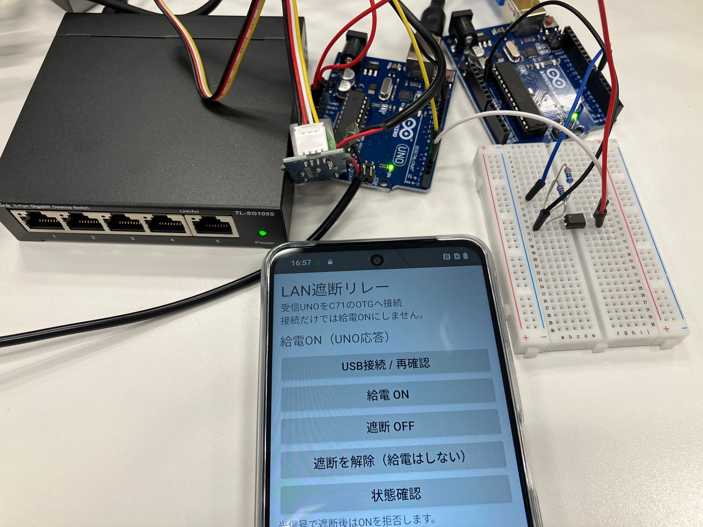

# Optical LAN Cutoff

An experimental defensive security prototype that connects decoy detection, Arduino-based emergency signaling, optical communication, LAN switch power control, and event logging on a separate PC.

On November 1, 2026, integration tests covered six simulated detection categories, from automatic notification to the receiver's latched cutoff state and saved reports.



*Hardware prototype on the test bench. The phone shows the earlier relay-control interface; the integration results below use the Windows receiver application.*

## How it works

```text
Decoys and detection
        |
Arduino transmitter
        |
One-way optical signaling
        |
Arduino receiver
        |--------------------|
LAN switch power control   Windows event logger
                            on a separate PC
```

The decoy host sends emergency notifications and compact, fixed-format reports through an optical path. The receiver controls power to the LAN switch and passes events to a separate PC for logging. Reporting continues while the receiver holds the cutoff state.

## Main features

- Multiple decoys with simulated activity and anomaly detection.
- Automatic notification from detection software to Arduino.
- Optical transmission of emergency signals and fixed-format reports.
- Receiver-side cutoff latching and event history.
- A Windows application for receiving and saving reports.
- An intake interface for external security detections.

## Verified results

| Test area | Observed result |
| --- | --- |
| Decoy and notification software | 16 tests passed |
| Windows receiver application | 16 separate self-tests passed |
| Automatic hardware notifications | Verified for all six simulated detection categories |
| Optical emergency reception | Six new emergency events recorded by the receiver |
| Receiver state and reporting | Cutoff state remained latched; 53 reports across six categories were recorded in the evaluated period |

These results combine transmitter-side test records with a receiver-log summary supplied from the separate PC. They describe the tested experimental setup. See the [validation summary](VALIDATION.md) for the evidence scope.

## Documentation

- [System overview](SYSTEM_OVERVIEW.md)
- [Validation summary](VALIDATION.md)
- [Project summary](PROJECT_SUMMARY.md)

This repository presents the project overview, a hardware photograph, and verified experimental results.
